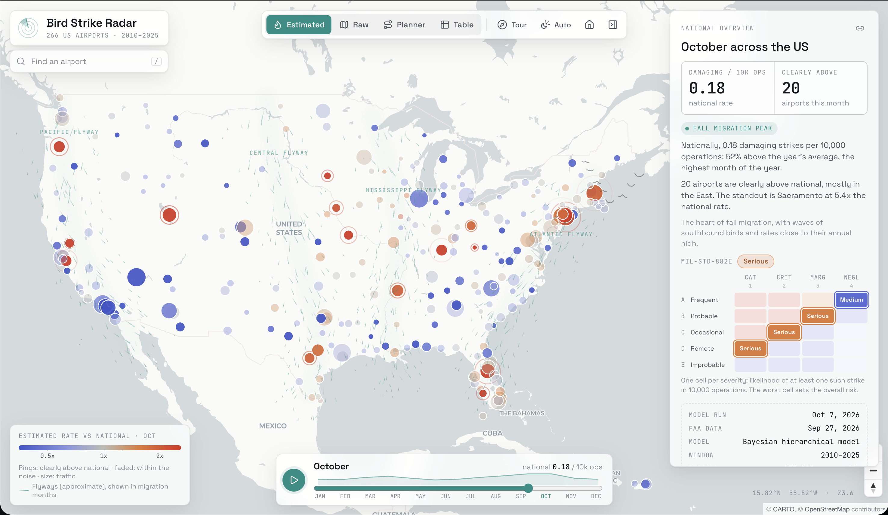

# Bird Strike Radar

An interactive map of damaging bird-strike risk at US commercial airports, treated as a **system safety
problem**. A Bayesian hierarchical model estimates how often aircraft are damaged by bird strikes at each
airport in each month, with honest uncertainty, and a Mission Planner turns that into the chance of a
damaging strike for a planned set of operations, classified with the public MIL-STD-882E risk matrix.

**Live map: https://donpams.github.io/bird-strike-radar/**



Built only on public data. Not affiliated with any employer or program. **Not for operational use.**

## What it shows

- **Map:** 266 airports, coloured by their estimated damaging-strike rate relative to the national rate
  for the same month. Airports that can't be told apart from national are faded, so only differences
  the data supports stand out. Play through the year to watch the spring and autumn migration waves.
- **Raw vs estimated:** flip to each airport's own counts to see why pooling matters.
- **Airport panel:** 12-month chart with a 90% interval, a plain-English summary, and the 882E matrix cell
  for every severity.
- **Mission Planner:** pick an airport, month and number of operations. It gives the expected damaging
  strikes, the chance of at least one, the 882E risk *for that plan's exposure*, the same plan in other
  months, and nearby airports. Comparisons are only called "clear" when the 90% intervals don't overlap.
- **Results:** how well the model forecast years it never saw, how it compared with simpler approaches,
  and what it doesn't prove. Open it from the toolbar, or link straight to it with `#view=results`.

## Key results

| | |
|---|---|
| Data | 242,449 FAA strike reports (2010-2025); 266 airports chosen by traffic only, never by strike counts; **5,513 damaging strikes** |
| Outcome | Strikes with *known* damage (FAA levels M, M?, S, D). Unknown damage is excluded, not treated as "none" |
| Model | Negative binomial with a traffic offset; national and flyway seasonality, airport and airport-season effects, a year random walk and airport trends (NumPyro, NUTS) |
| Model checks | Simulation with known truth: 92% of 90% intervals contain it; typical error 38% vs 54% for the simpler baseline. Real fit: 0 divergences, R-hat ≤ 1.007, posterior predictive checks pass |
| Forecast test | Fitted on 2010-2022, scored on 2023-2025: beats the baseline by ~5 standard errors on log score; forecast 1,149 (1,012-1,313) damaging strikes vs **1,264 observed**. The baseline's range (1,000-1,110) missed |
| Honest miss | 2025 came in above the model's 90% range, so its forecasts lean low; [failure cases listed](reports/week5_evaluation.md#failure-cases) |
| 882E finding | With the standard's thresholds unmodified, every airport-month is Serious (93%) or High (7%) per 10,000 operations: a rare but credible catastrophic outcome is enough. The planner shows how the level changes with the exposure you define |

What could go wrong with the tool itself, and how each risk was tested: **[docs/WHAT_COULD_GO_WRONG.md](docs/WHAT_COULD_GO_WRONG.md)**

## Reports

1. [Data quality](reports/week1_data_quality.md): what's missing, and why missingness isn't random
2. [Baseline and 882E risk logic](reports/week2_baseline_and_risk.md)
3. [Hierarchical model](reports/week4_hierarchical_model.md) and its [simulation check](reports/week4_simulation_check.md)
4. [Forecast evaluation on held-out years](reports/week5_evaluation.md)

## Data sources

| Source | What it gives |
|---|---|
| [FAA National Wildlife Strike Database](https://wildlife.faa.gov/) | Strike reports |
| [FAA ATADS](https://www.aspm.faa.gov/opsnet/sys/Airport.asp) | Monthly tower operations per airport |
| [OurAirports](https://ourairports.com/data/) | Coordinates and ICAO/FAA identifier crosswalk |
| MIL-STD-882E (public) | Severity categories, probability levels, risk matrix |

Raw and processed data are not committed. Reporter names, remarks, and tail and flight numbers are dropped
at load and never reach processed data or the site.

## Run it

```bash
uv sync
uv run pytest                                   # Python tests
uv run python -m bird_strike_radar.pipeline     # raw data -> processed tables, reports, web/public/data/radar.json
                                                # (the two model fits take several minutes; SKIP_HIER=1 reuses the last ones)
cd web && npm install
npm test                                        # planner maths + check that the site agrees with the Python model
npm run dev                                     # http://localhost:5173/bird-strike-radar/
```

## How it's built

```
FAA strikes ─┐
ATADS ops ───┼─> ingest + checks ─> study airports ─> panel (airport × year × month)
OurAirports ─┘                                          │
                         ┌──────────────────────────────┼─────────────────────┐
                    Week 2 baseline              Week 4 hierarchical     Week 5 holdout
                    (empirical Bayes)            model (NumPyro)         evaluation
                                                        │
                                       882E risk ─> radar.json ─> React + MapLibre site (GitHub Pages)
```

`src/bird_strike_radar/` holds the Python pipeline, `tests/` its tests, and `web/` the site. The site is
static: one versioned JSON file, no backend.

## Limitations

- Reports are voluntary. A higher rate can mean more hazard *or* more thorough reporting, and strike data
  alone can't separate the two.
- Every operation at an airport is treated alike: no time of day, altitude, aircraft type or runway yet.
- Severity shares are national, not airport-specific.
- Counting only known-damage strikes is a slight, documented underestimate.
